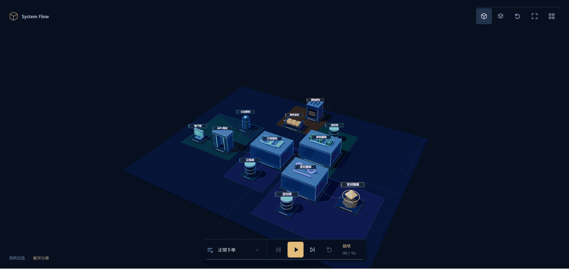
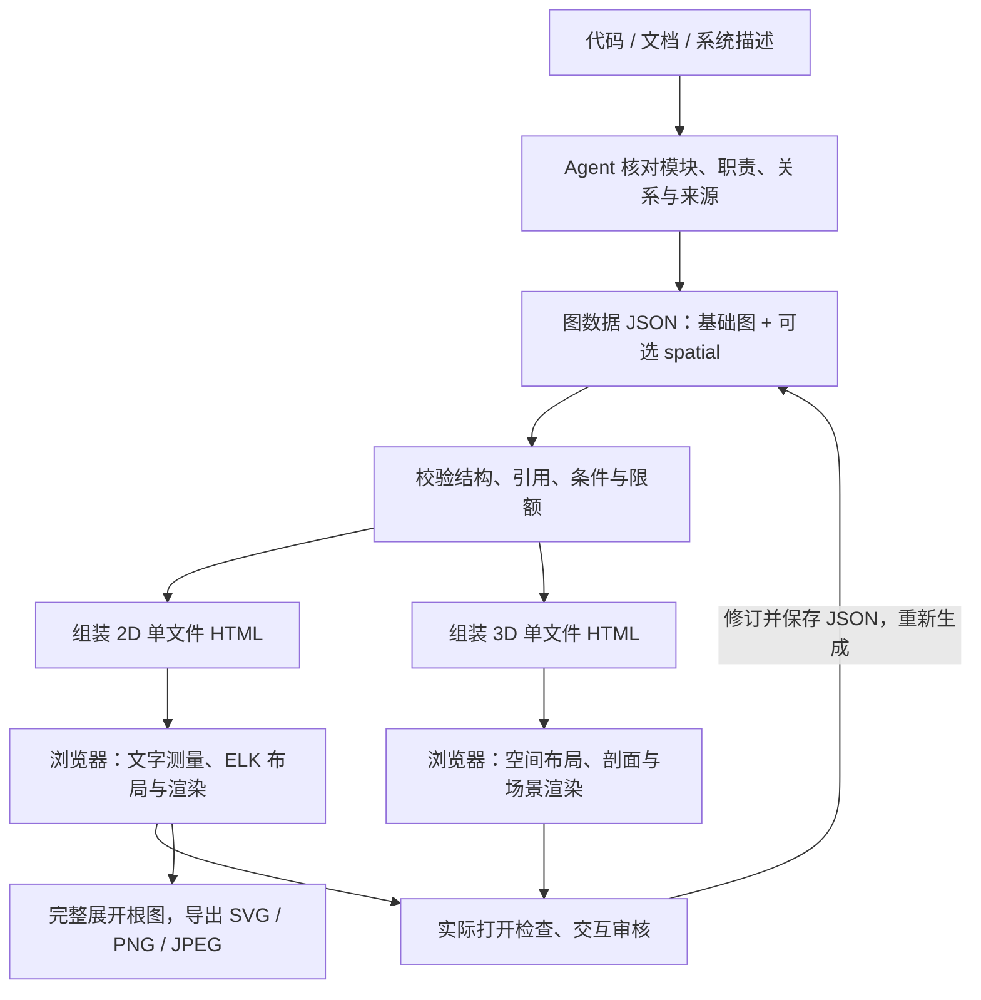

<div align="center">

# 3D System Flow

**把软件架构变成可探索的 3D 沙盘，以及可审核的 2D 流程图。**

从代码、文档或系统描述建立图数据，离线查看模块、展开内部组件、沿请求步骤探索，也可生成 README 和文档所需的二维静态图。

    

[效果预览](#效果预览) · [核心能力](#核心能力) · [快速开始](#快速开始) · [安装 Skill](#安装-skill) · [下载 Skill ZIP](https://github.com/JX05120LLL/3D-System-Flow/releases/latest)

</div>

## 项目简介

3D System Flow 是面向**软件架构与运行流程**的可复用本地 Skill。Agent 阅读仓库、设计文档或系统描述，核对模块与关系，并写入 `.diagram.json`；同一份数据可以生成两种阅读方式：

- **3D 沙盘**：在空间中探索系统，展开模块剖面、查看组件职责，播放显式编排的请求演示。
- **2D 流程图**：阅读完整条件与分组，审核修订已有对象，并导出 SVG / PNG / JPEG。

每张图保留可继续修改的 JSON 和单文件交互 HTML。`system-flow/` 包含建模规则、示例、脚本和已构建的 2D/3D 运行时；换一份系统数据即可生成新图。HTML 内嵌图数据、样式与脚本，3D 已内嵌 Three.js，阅读不需要账号、服务器或网络。CLI 未指定渲染方式时仍默认生成 **2D**。

## 效果预览

下面是微服务示例的压缩录屏预览：从全部模块的沙盘总览进入订单、库存和支付服务内部，再随下单步骤联动查看组件。点击图片可单独播放 GIF；[高清原始录屏](images/示例.gif)保留完整画面。

[](images/system-flow-demo.gif)

GIF 展示操作过程；交互体验需要按[快速开始](#快速开始)生成并打开 HTML。可旋转、缩放、平移，切换俯视/立体并复位视角；点选模型或对象列表后展开剖面、查看职责、聚焦和高亮上下游。演示支持播放/暂停、前后单步与重置，步骤会自动展开相关模块；点选对象或查看关联、职责时暂停播放。

Skill 自带[微服务](system-flow/examples/microservices-spatial.diagram.json)和[文档处理](system-flow/examples/document-pipeline-spatial.diagram.json)两份数据，均可生成 2D 与 3D。内部职责和演示步骤是明确的**教学假设**，使用时需按实际系统核对；位置、体积和播放路径不代表真实部署、容量或实时 trace。

## 核心能力

| 能力 | 说明 |
| --- | --- |
| 3D 总览 | 本地空间布局、模型和短名牌；旋转、缩放、平移、俯视/立体切换、复位与全屏。 |
| 模块剖面 | 按数据展开单层内部组件；多个模块可独立展开，组件职责通过点选按需显示。 |
| 关联探索 | 对象列表、聚焦、上下游高亮与隔离；根模块查看根图关系，内部组件查看所属内部图关系。 |
| 编排演示 | 显式场景与有序步骤；播放/暂停、前后单步、重置和切换场景，自动展开相关剖面并定位焦点。 |
| 2D 阅读 | 先测量文字，再用 ELK.js 布局；横向/纵向切换、缩放平移、详情、上下游高亮与两层分组折叠，保留判断条件和异常回路。 |
| 2D 审核 | 修改已有节点、连接或分组的描述、来源、端点与条件等；校验后重新布局，支持撤销/重做、下载图数据和修订 HTML。 |
| 离线与导出 | 两种 HTML 均为单文件；2D 静态导出完整展开的 SVG / PNG / JPEG，3D 在 WebGL 不可用时保留对象与职责/步骤文字。 |

2D 详情板修改的是**图的描述**，不会修改系统代码。增删对象、修改 ID 或调整 3D 内容时，编辑 JSON 后重新生成；`file://` 页面不会自动覆盖原文件。3D 不提供 2D 的详情编辑、分组折叠和静态导出功能。

## 图数据与复用

基础图使用 `schemaVersion: "2.0"`，以 `nodes`、`edges`、`groups` 和 `view` 表达模块、关系、边界与阅读方向。可选 `spatial` 扩展在同一份数据中描述三维内容：

| 字段 | 如何复用 |
| --- | --- |
| `spatial.interiors` | 为根模块指定 `owner` 和内部 `nodes` / `edges`，描述单层组件及职责；归属由 `owner` 决定。 |
| `spatial.models` | 为根或内部节点选择形态、颜色与短名牌；完整说明保留在节点 `summary` / `details`。 |
| `spatial.scenarios` | 显式定义场景与步骤，使用 `route` 指定阅读路径、`focusId` 指定焦点，并写明步骤说明。 |

替换示例的模块、组件、关系和步骤后，运行同一套 validate / generate 入口即可生成自己的系统。没有 `spatial` 的旧图也可生成 3D 根图；没有内部图的模块不补造组件，没有场景时隐藏演示入口。源码、文档和明确需求是依据；使用 `confirmed`、`assumed`、`planned` 区分已证实、假设与规划，并保留 `sources`。步骤必须依据证据或明确教学假设编排，不能由依赖边自动推导执行顺序。完整字段见[建模说明](system-flow/references/modeling.md)和[3D 建模与验收](system-flow/references/spatial.md)。

## 工作流程



两种渲染都先校验图数据。CLI 组装单文件 HTML，浏览器打开后执行布局与渲染；生成成功后仍需实际检查。2D 可下载审核后的 JSON 与 HTML，3D 内容修订后重生成。需要静态图片时，使用同一 JSON 的 **2D HTML** 导出根图；内部组件的静态图需另建二维模型。

## 技术栈

| 环节 | 技术 |
| --- | --- |
| 模型校验 | JSON Schema、Ajv |
| 布局与渲染 | 2D：ELK.js、SVG / CSS、d3-zoom；3D：Three.js 与本地空间布局 |
| 单文件构建 | TypeScript、esbuild |
| 浏览器验证与位图导出 | Playwright、Chromium |

## 项目结构

```text
system-flow/        可独立安装的 Skill、已构建运行时和导出脚本
  examples/         含内部组件与编排步骤的微服务、文档处理图数据
  references/       建模、空间扩展与视觉验收说明
src/                模型、投影、测量、布局、2D/3D 阅读器与 CLI 源码
scripts/            构建、示例检查、独立包验证与 ZIP 打包
images/             README 压缩预览与原始录屏
tests/              单元测试、浏览器回归与测试输入
```

## 快速开始

### 1. 获取完整 Skill

需要 **Node.js 24.x**。从 [Releases](https://github.com/JX05120LLL/3D-System-Flow/releases/latest) 下载并解压 `system-flow-v2.1.0.zip`，或克隆仓库：

```bash
git clone https://github.com/JX05120LLL/3D-System-Flow.git
cd 3D-System-Flow
```

在**包含 `system-flow/` 的父目录**打开终端。发布 ZIP 内也有这一层目录，以下路径适用于两种获取方式。

生成只需要完整 Skill 目录和 Node.js，无需安装开发依赖或 Three.js。

### 2. 生成并探索示例

```bash
node system-flow/scripts/validate.mjs system-flow/examples/microservices-spatial.diagram.json
node system-flow/scripts/generate.mjs system-flow/examples/microservices-spatial.diagram.json --renderer 3d --output output/microservices-3d.html
node system-flow/scripts/generate.mjs system-flow/examples/microservices-spatial.diagram.json --renderer 2d --output output/microservices-2d.html
node system-flow/scripts/generate.mjs system-flow/examples/document-pipeline-spatial.diagram.json --renderer 3d --output output/document-pipeline-3d.html
```

直接用浏览器打开 `output/microservices-3d.html`，无需启动服务；断网后也可阅读。先查看总览，点击订单、库存或支付服务查看内部组件，再播放下单演示。鼠标拖动旋转、滚轮缩放、右键平移，顶部可切换俯视/立体、复位和全屏。

在焦点不处于输入、按钮或选择控件时，`Space` 播放/暂停，`←` / `→` 前后单步；`Esc` 先关闭对象列表，再返回总览。手动选中对象或查看关联会暂停演示，页面进入后台也会暂停。3D 需要 WebGL；不可用时保留对象列表、职责与步骤文字，空间控件禁用。

`--renderer 2d|3d` 默认为 `2d`。文件默认不覆盖，重新生成时显式加 `--overwrite`；参数说明使用 `node system-flow/scripts/generate.mjs --help`。

### 3. 按需导出二维静态图

自动导出 SVG / PNG / JPEG 需要本地 Playwright 和 Chromium；在 Skill 子目录安装一次即可：

```bash
npm ci --prefix system-flow
node system-flow/node_modules/playwright/cli.js install chromium
node system-flow/scripts/export.mjs output/microservices-2d.html --format svg --output output/microservices.svg
node system-flow/scripts/export.mjs output/microservices-2d.html --format png --scale 2 --output output/microservices.png
node system-flow/scripts/export.mjs output/microservices-2d.html --format jpg --background "#FFFFFF" --output output/microservices.jpg
```

2D 浏览器工具栏也可直接下载 SVG。CLI 导出默认不覆盖已有文件，可显式加 `--overwrite`；静态输出完整展开根图，不包含当前缩放、选中状态或动效。3D HTML 不支持此导出入口，内部剖面与场景保留在 JSON 和 3D HTML 中。

## 安装 Skill

1. 从 [GitHub Releases](https://github.com/JX05120LLL/3D-System-Flow/releases/latest) 下载 `system-flow-v2.1.0.zip` 与 `SHA256SUMS.txt`，或直接使用仓库中的 [`system-flow/`](system-flow/) 目录。
2. 解压后将完整的 `system-flow/` 复制到编程工具的 Skills 目录，保持目录名为 `system-flow`。以 Codex 为例，个人安装路径为 `~/.agents/skills/system-flow/`，项目安装路径为 `<项目>/.agents/skills/system-flow/`，见 [OpenAI 官方安装说明](https://learn.chatgpt.com/docs/build-skills)。其他支持 `SKILL.md` 的工具按各自配置选择目录。
3. 保留整个目录，包括 `SKILL.md`、`LICENSE`、第三方声明、`agents/`、`assets/`、`references/`、`examples/`、`scripts/`、`package.json` 与锁文件。安装 Node.js 24.x 后即可生成；自动静态导出需在实际安装的 Skill 目录执行 `npm ci` 并安装 Chromium。

项目名称为 **3D System Flow**，Skill 的展示名和触发名为 **System Flow / `system-flow`**。在 Codex CLI / IDE 中可用 `/skills` 查看，用 `$system-flow` 显式调用；安装后若未出现，重启 Codex 再检查。ZIP 包含已构建的 2D/3D 运行时和示例数据，生成不依赖仓库源码或开发环境。

**生成 3D 沙盘与请求演示：**

```text
使用 $system-flow，为这个仓库生成 3D 架构沙盘。
核对主要模块、内部组件职责和调用依据，提供可展开的模块剖面，
为关键请求显式编排可暂停、前后单步与重置的演示。
区分已证实、假设和规划，保留来源；交付 .diagram.json 与离线 3D HTML。
实际检查选择、职责、上下游、剖面与演示联动，并说明未验证项。
```

**生成 2D 审核图与 README 图片：**

```text
使用 $system-flow，核对这个仓库的主要模块和调用关系，生成 2D 架构总览及关键请求流程。
保留判断条件、异常回路、分组边界和来源，区分已证实、假设和规划。
交付 .diagram.json、离线交互 HTML 与 README 可嵌入的 SVG，
实际打开检查文字、连线、方向和交互，并标明尚待人工核对的地方。
```

安装后的调用使用 Skill 实际目录作为 `<skill-dir>`，用户工作目录作为输入/输出路径；入口命令见 [SKILL.md](system-flow/SKILL.md#可执行入口)。安装 Skill 不需要仓库的 `src/`、`prototypes/` 或根开发依赖。

## 开发检查

以下仅供修改项目源码时使用，在**仓库根目录**执行；生成现有示例无需此流程。ZIP 打包另需 `python` 命令可用（Python 3.10+）。先安装依赖和浏览器，再运行检查：

```bash
npm ci
npm ci --prefix system-flow
node system-flow/node_modules/playwright/cli.js install chromium
npm run typecheck
npm run test:unit
npm run build
npm run check:build
npm run test:browser
npm run examples:check
npm run test:package
npm run package:skill
```

`examples:check` 检查二维测试示例的生成/导出和两份三维示例的离线交互；`test:package` 从独立复制的 Skill 目录检查 2D 生成/导出与 3D 离线运行。`package:skill` 输出 `artifacts/release/system-flow-v2.1.0.zip` 与 `archive.json`，后者记录归档 SHA-256 和逐文件校验；发布页面的 `SHA256SUMS.txt` 是另行准备的校验文件。ZIP 不含本地依赖、浏览器缓存或测试产物。2D 静态图和 3D 交互应分别实际打开验收。

## 更多文档与限制

- [Skill 使用说明](system-flow/SKILL.md)：生成、交互审核、静态导出与交付约束。
- [微服务图数据](system-flow/examples/microservices-spatial.diagram.json)：模块、内部组件与下单步骤教学示例。
- [文档处理图数据](system-flow/examples/document-pipeline-spatial.diagram.json)：第二种系统的空间建模教学示例。
- [建模说明](system-flow/references/modeling.md)：字段、条件、分组与事实状态。
- [3D 建模与验收](system-flow/references/spatial.md)：单层内部组件、形态、步骤、离线与降级检查。
- [JSON Schema](system-flow/references/diagram-schema.json)：完整字段、引用范围与校验约束。

当前根图和全部内部图合计最多 **100 节点 / 300 边**，输入最多 **2 MiB**；根分组最多 20 个、两层，内部剖面只支持一层，复杂系统应按范围拆图。自动布局仍需人工检查文字、方向、遮挡与连线。

场景用于解释系统，不执行请求、不修改业务数据，也不表示实时监控。图数据与完整职责会嵌入 HTML，分享前应核对内容与来源。旧 v1 HTML / SVG 可使用兼容入口导出位图，但不能无损转换为可编辑图数据；详细限制见 [SKILL.md](system-flow/SKILL.md)。

## 开源许可证

本项目的原创内容采用 [MIT License](LICENSE)。独立复制 `system-flow/` Skill 时，请一并保留其中的 [LICENSE](system-flow/LICENSE)；所含第三方组件仍遵循各自的许可证，详见[第三方声明](system-flow/THIRD_PARTY_NOTICES.md)。
